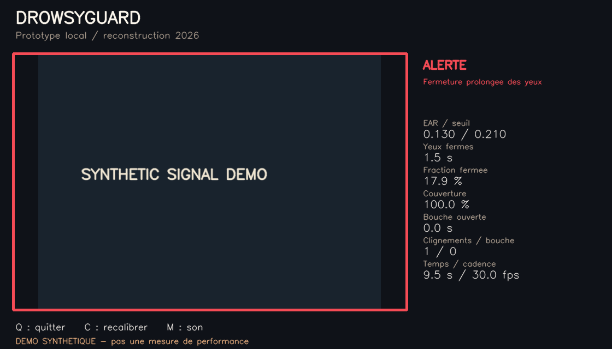

# DrowsyGuard

Application locale de démonstration pour observer certains **signaux visuels compatibles avec la somnolence** : fermeture prolongée des yeux, fraction de temps yeux fermés et ouverture prolongée de la bouche.

**Nouvelle implémentation réalisée en novembre 2026 après perte des sources du projet académique de 2024.** Ce dépôt n'est pas une restauration des fichiers historiques. Développé avec assistance IA ; les fonctions, essais et limites sont documentés pour permettre leur compréhension et leur modification.



La capture utilise des signaux fabriqués pour présenter l'interface ; elle ne démontre pas une détection sur un conducteur.

## Démarrer

Après l'installation ci-dessous, double-cliquer sur **Demarrer.bat** pour lancer la webcam. Une fenêtre affiche le visage, les repères utilisés, l'état et les mesures.

Pendant la calibration, regarder la caméra avec les yeux normalement ouverts pendant au moins cinq secondes ; éviter les mouvements importants. Les clignements courts restent possibles. La calibration n'est pas une preuve que les yeux sont ouverts : une mauvaise référence peut entraîner des faux résultats. Recommencer avec **C** si nécessaire.

- **Q** ou Échap : quitter et libérer la caméra.
- **C** : recommencer la calibration et les compteurs.
- **M** : activer/désactiver le son. Sous Windows, l'alerte sonore est exécutée dans un fil séparé.
- **Demo_sans_camera.bat** : démonstration avec signaux fabriqués, sans activer la webcam.

## Installation Windows

Installer Python **3.12 64 bits**, puis double-cliquer sur **Installer.bat**. Il crée un environnement isolé, installe les versions verrouillées et télécharge explicitement le modèle officiel. Aucun GPU requis. Prévoir environ 600 Mo de marge pour l'environnement, le modèle et les fichiers temporaires. Internet est nécessaire pour cette installation ; l'analyse fonctionne ensuite localement.

```powershell
py -3.12 -m venv .venv
.\.venv\Scripts\python.exe -m pip install --no-cache-dir --only-binary=:all: -r requirements-lock.txt
.\.venv\Scripts\python.exe -m drowsyguard download
.\.venv\Scripts\python.exe -m drowsyguard doctor
.\.venv\Scripts\python.exe -m drowsyguard run
```

Ne pas installer simultanément opencv-python et opencv-contrib-python : ils partagent le module `cv2`. Ce projet utilise uniquement la distribution contrib requise par MediaPipe.

## Vidéo, paramètres et exports

```powershell
# Une autre webcam :
.\.venv\Scripts\python.exe -m drowsyguard run --camera 1

# Une vidéo locale ; temps calculé avec la cadence déclarée dans le fichier :
.\.venv\Scripts\python.exe -m drowsyguard run --video "C:\Videos\essai.mp4"

# Export des mesures, sans enregistrer les images :
.\.venv\Scripts\python.exe -m drowsyguard run --video "C:\Videos\essai.mp4" --headless --no-calibrate --output outputs/essai-01

# Paramètres personnalisés, d'après config.example.json :
.\.venv\Scripts\python.exe -m drowsyguard run --config config.example.json

# Démonstration reproductible sans caméra ni modèle :
.\.venv\Scripts\python.exe -m drowsyguard demo --headless --output outputs/demo-01
```

`--no-calibrate` utilise le seuil fixe de configuration : il est moins personnalisé. Il ne faut pas comparer les valeurs de seuil entre personnes comme une mesure de santé. Une vidéo à cadence variable peut avoir des horodatages incompatibles avec l'hypothèse cadence constante : les durées affichées peuvent alors être inexactes.

Chaque nouveau dossier d'export contient `metrics.csv`, `summary.json` et `report.html`. Les exports existants ne sont pas écrasés. Aucun export n'est réalisé sans `--output`. La démo peut produire une capture du tableau de bord synthétique ; la commande webcam ne sauvegarde pas d'images.

## Comment cela fonctionne

1. Le modèle **MediaPipe Face Landmarker** fournit les repères d'un visage. S'il détecte plusieurs visages, l'observation est rejetée. Aucun système d'identification de personne n'est utilisé.
2. Des filtres géométriques rejettent un visage trop petit, hors cadre ou fortement incliné/asymétrique. Ils ne certifient pas la qualité des yeux détectés, notamment avec lunettes, reflets ou occultations.
3. L'**Eye Aspect Ratio** (EAR) compare les distances verticales et horizontales de six points de chaque œil, en pixels. La moyenne des deux yeux est utilisée ; les points sont remis à l'échelle de l'image pour ne pas déformer le rapport sur une webcam 16:9.
4. La calibration estime une référence à partir du troisième quartile des EAR observés et fixe un seuil à 70 % de cette référence, avec bornes. Ce choix est heuristique.
5. Le moteur utilise des **durées**, pas un nombre fixe d'images. Une fermeture d'au moins 1,5 seconde déclenche une alerte. La fraction de temps sous le seuil est calculée sur 30 secondes, avec au moins 15 secondes mesurées et 80 % de couverture avant de pouvoir déclencher une alerte à 28 %.
6. La bouche ouverte pendant deux secondes produit un avertissement distinct : parler ou chanter peut produire le même signal. Aucun classificateur de bâillement n'a été entraîné.

La fraction mesurée est un **proxy géométrique de temps yeux fermés**, pas un PERCLOS validé physiologiquement. Une cadence insuffisante, un visage absent ou une interruption de plus de 350 ms interrompt les durées continues. Ces périodes ne sont jamais traitées comme des yeux ouverts. Le rapport conserve la couverture observable et ne relie pas les segments absents de la courbe.

## Vérifications et preuves

```powershell
.\.venv\Scripts\python.exe -m unittest discover -s tests -v
.\.venv\Scripts\python.exe scripts/integration_check.py --download-fixture
```

- Tests déterministes de la logique temporelle : clignements courts, latence d'alarme à plusieurs cadences, fenêtres glissantes, pertes du visage, calibration, validation des entrées et exports.
- Vérification du véritable modèle sur un portrait de test officiel MediaPipe et des images vides ; résultats dans `reports/integration.json` après exécution.
- Scénario synthétique pour le tableau de bord et les transitions d'état : **aucun taux de précision de détection de somnolence n'en est déduit**.
- Le portrait sert uniquement à vérifier le chargement et la chaîne d'inférence. Il n'est pas redistribué dans l'archive source ; sa provenance et son empreinte sont enregistrées dans le rapport.

Aucune validation sur un jeu de conducteurs annoté ni essai webcam humain n'est supposé depuis ces tests. Voir `docs/VALIDATION.md` pour le bilan réellement exécuté et le protocole manuel à compléter.

## Limites et usage

Projet pédagogique et portfolio. **Ne pas l'utiliser pour conduire, superviser une machine ou décider qu'une personne peut continuer une activité dangereuse.** La lumière, les lunettes, les angles, les occultations, les différences morphologiques et la cadence peuvent provoquer de faux positifs ou des détections manquées. « Surveillance » signifie uniquement qu'aucune règle n'a été déclenchée, pas que la personne est éveillée ou apte à conduire.

Les images restent sur le PC. L'application n'envoie ni vidéo ni mesures vers un service distant. Seul le téléchargement explicite du modèle et l'installation des dépendances utilisent Internet.

## Sources et attribution

- [Documentation officielle Face Landmarker](https://ai.google.dev/edge/mediapipe/solutions/vision/face_landmarker/python).
- [Tests officiels MediaPipe utilisant portrait.jpg](https://github.com/google-ai-edge/mediapipe/blob/master/mediapipe/tasks/python/test/vision/face_landmarker_test.py).
- Soukupová et Čech, [Real-Time Eye Blink Detection using Facial Landmarks, CVWW 2016](https://cmp.felk.cvut.cz/ftp/articles/cech/Soukupova-CVWW-2016.pdf) : inspiration pour l'EAR ; ce projet n'implémente pas leur classificateur temporel entraîné.
- [OpenCV](https://docs.opencv.org/4.x/), [MediaPipe](https://github.com/google-ai-edge/mediapipe), [NumPy](https://numpy.org/).

Les seuils temporels de cette V1 sont des paramètres de démonstration, pas des seuils cliniquement validés. Voir `THIRD-PARTY-NOTICES.md`. Code neuf du projet : licence MIT ; les dépendances et modèles conservent leurs conditions propres.

